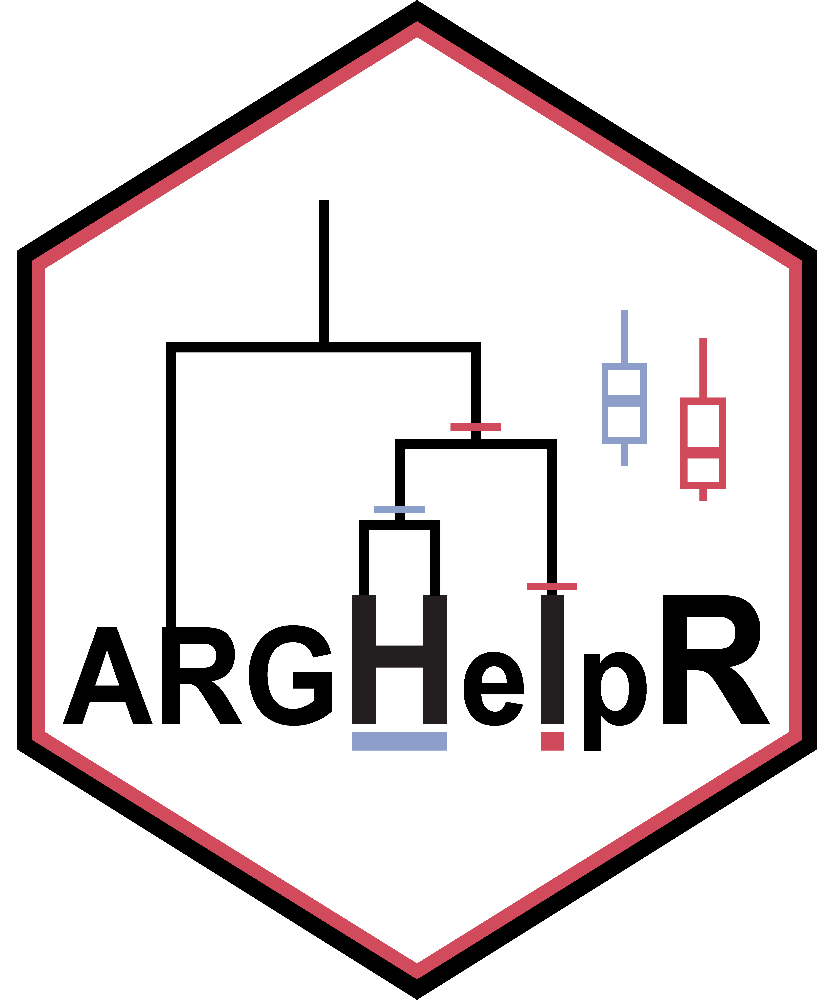

# ARGHelpR version 1.0.0 

## What is *ARGHelpR*?

*ARGHelpR* is an R package that summarizes and visualizes ancestral
recombination graphs (ARGs). *ARGHelpR* allows researchers to identify
specific regions of the genome that may be influenced by some form of
selection and those that may be involved in specific processes such as
introgression. Please see our
[vignette](https://kfarleigh.github.io/ARGHelpR/articles/arghelpr-vignette.html)
and tutorials using the articles dropdown tag to see how you can
identify these regions in your own data and how you can convert your
output from different ARG programs into the format needed to use
*ARGHelpR*.

We plan to continue developing the package to include more functions,
feel free to reach out to Keaka Farleigh if you have any suggestions or
would like to collaborate.

## Installation

You can install the development version of ARGHelpR from
[GitHub](https://github.com/) with:

``` r

# install.packages("pak")
pak::pak("kfarleigh/ARGHelpR")
```

## Citing *ARGHelpR*

*ARGHelpR* is currently in review. You can use the citation below in the
meantime. Thanks for your interest!

Farleigh, K., Highland, D.K., Alderman, M.G., Faber, E.M., Westermann
Salas, L., & Schield, D.R. ARGHelpR: An R package to identify evidence
of selection and introgression using ancestral recombination graphs. *In
Review*.
